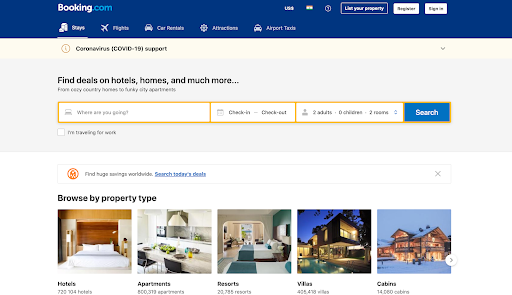

# README.md
​
Before starting with the coding it is essential to go through our documentation. So that you have a fair idea on how to contribute with the format organisation follows.
​
### Demo

​
### Screenshots

  
Home Page:

  
 
   ​
  
Entity Page:

  
   ​
  
Map Section:

  
   ​
  
Payment Section:

  

​
### Code of Conduct
https://github.com/masai-oss/open-template/wiki/Code-of-Conduct
​
### Code Guide
https://github.com/masai-oss/open-template/wiki/Code-Guide
​
### First Contributor
https://github.com/masai-oss/open-template/wiki/First-Contributor
​
### Contributor
https://github.com/masai-oss/open-template/wiki/Contributor
​
### Commit Guide
https://github.com/masai-oss/open-template/wiki/Commit-Guide
​
### Issue Template
https://github.com/masai-oss/open-template/wiki/Issue-Template
​
### Pull Request Guide
https://github.com/masai-oss/open-template/wiki/Pull-Request-Template

### Virtual Environment Guide
https://github.com/masai-oss/open-template/wiki/Virtual-Environment-Guide
​
### Backend Guide
https://github.com/masai-oss/open-template/wiki/Backend-Guide
​
### Frontend Guide
https://github.com/masai-oss/open-template/wiki/Frontend-Guide

https://github.com/masai-oss/open-template/wiki/Cypress-Guide

https://github.com/masai-oss/open-template/wiki/OAuth-Guide
​
It is very important to read these documents throughly before starting to code.
